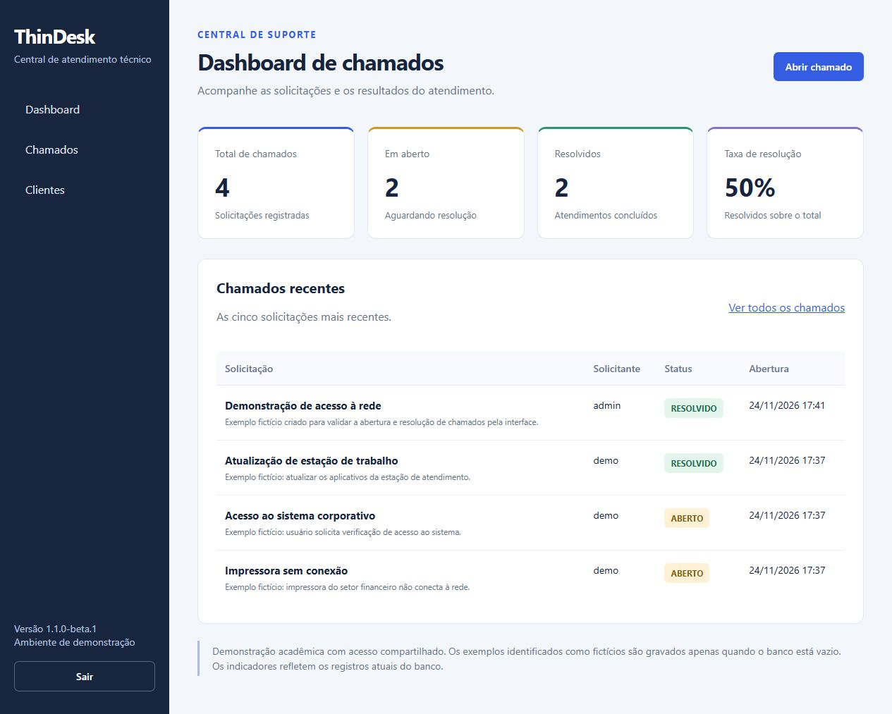

# ThinDesk — Controle de chamados técnicos

Sistema corporativo de atendimento técnico desenvolvido com Java, Spring Boot, Spring Security, Thymeleaf e MongoDB. Permite autenticar, abrir chamados, acompanhar solicitações e registrar sua resolução.

## Aplicação publicada e login de demonstração

**Acesse:** [ThinDesk online](https://thindesk-production-732de546.up.railway.app/login)

| Campo | Credencial de demonstração |
| --- | --- |
| Usuário | `admin` |
| Senha | `thindesk` |

Qualquer pessoa com o link pode acessar com essas credenciais. Não é necessário criar conta no Railway ou no GitHub para usar a aplicação. O acesso é compartilhado e destinado à avaliação acadêmica: utilize apenas informações fictícias.

## Versionamento semântico

**Versão atual: `1.1.0-beta.1`**, declarada também no `pom.xml` e na interface do sistema.

O projeto adota o formato **MAJOR.MINOR.PATCH[-PRÉ-LANÇAMENTO]**, de acordo com o [Semantic Versioning 2.0.0](https://semver.org/lang/pt-BR/):

| Parte | Valor atual | Significado |
| --- | --- | --- |
| MAJOR | `1` | Linha principal do sistema; aumenta quando há mudanças incompatíveis. |
| MINOR | `1` | Inclusão de funcionalidades compatíveis: dashboard e operação de chamados pela interface, preservando as rotas da API. |
| PATCH | `0` | Nenhuma revisão corretiva publicada nesta linha `1.1`. As próximas correções sem novas funcionalidades usarão `1.1.1`, `1.1.2` etc. |
| Pré-lançamento | `beta.1` | Primeira versão beta desta linha: disponível para avaliação e ainda sujeita a validação e melhorias. Não representa uma versão final de produção. |

O código recebido utilizava `1.0-alpha`, que não contém os três componentes numéricos do SemVer. A entrega passa a padronizar a versão como `1.1.0-beta.1`. Exemplo de evolução: `1.1.0-beta.1` → `1.1.0-beta.2` → `1.1.0` → `1.1.1` → `1.2.0`; uma alteração incompatível deve avançar para `2.0.0`.

## Dashboard



Captura realizada em 24/11/2026, às 17h41 (horário de Brasília), da aplicação executando o código deste repositório. A tela mostra o total de chamados, os chamados abertos e resolvidos, a taxa de resolução e as cinco solicitações mais recentes. Os indicadores são calculados a partir do MongoDB; os números podem mudar conforme o uso do acesso compartilhado.

Quando o banco está vazio, a inicialização grava três exemplos fictícios, sendo dois abertos e um resolvido. Os registros de demonstração são identificados nas descrições. A carga inicial preserva os chamados existentes; a correção de acentuação se limita aos textos dos exemplos fictícios da primeira publicação.

## Funcionalidades desta entrega

- Login e logout com sessão do Spring Security.
- Dashboard com indicadores obtidos dos chamados persistidos.
- Abertura de chamados pela interface e pela API REST.
- Consulta de chamados e registro da solução pelo usuário autenticado.
- Bloqueio de uma segunda resolução do mesmo chamado.
- Consulta de clientes cadastrados; o cadastro permanece disponível pela API.
- Layout responsivo e dados de demonstração para avaliação.

## Tecnologias e execução local

- Java 21, Maven e Spring Boot 3.4.0.
- Spring Web, Spring Security, Spring Data MongoDB e Thymeleaf.
- MongoDB e Docker para a hospedagem.

Pré-requisitos locais: JDK 21 e MongoDB na porta `27017`. Na raiz do projeto:

```powershell
.\mvnw.cmd spring-boot:run
```

Abra `http://localhost:8080/login` e use o mesmo acesso de demonstração.

Para configurar outro banco:

```powershell
$env:MONGODB_URI = 'mongodb://localhost:27017/thindesk'
.\mvnw.cmd spring-boot:run
```

Para gerar o executável com Maven instalado:

```text
mvn clean package
java -jar target/thindesk.jar
```

Os testes de integração precisam de MongoDB acessível durante a execução. A rotina em `.github/workflows/verify.yml` fornece um MongoDB isolado no GitHub Actions.

## Deploy

O deploy está configurado no Railway, com o serviço `thindesk` conectado à branch `main` deste repositório e o MongoDB com volume persistente. O `Dockerfile` compila o projeto e executa o JAR com Java 21. O `railway.toml` configura o build e a verificação de disponibilidade em `/login`.

| Variável | Finalidade |
| --- | --- |
| `MONGODB_URI` | Conexão privada com o serviço MongoDB (`${{MongoDB.MONGO_URL}}` no Railway). |
| `PORT` | Porta fornecida pela hospedagem; localmente usa `8080`. |
| `DEMO_USERNAME` | Usuário de demonstração; padrão `admin`. |
| `DEMO_PASSWORD` | Senha de demonstração; padrão `thindesk`. |

A disponibilidade depende da manutenção dos serviços e dos limites/créditos da conta Railway. A credencial publicada é exclusiva deste ambiente acadêmico; uma implantação de produção exige contas individuais, política de acesso e revisão de segurança. A configuração original da API mantém CSRF desabilitado nesta versão beta.

## API REST

As rotas exigem uma sessão autenticada. Ao abrir ou resolver um chamado, o servidor utiliza o usuário da sessão como solicitante ou técnico.

| Método | Rota | Descrição |
| --- | --- | --- |
| `POST` | `/api/chamados` | Abre um chamado com `titulo` e `descricao`. |
| `GET` | `/api/chamados/usuario/{id}` | Lista chamados pelo nome do usuário, por exemplo `admin`. |
| `GET` | `/api/chamados/{id}` | Consulta um chamado. |
| `PUT` | `/api/chamados/{id}/resolver` | Resolve um chamado com o campo `solucao`. |

Exemplo de abertura:

```json
{"titulo":"Computador sem rede","descricao":"Exemplo fictício: estação sem conexão."}
```

Exemplo de resolução:

```json
{"solucao":"Interface de rede reiniciada e acesso validado."}
```

Respostas previstas: `201` ao criar, `400` para campos obrigatórios ausentes, `401` sem autenticação nas APIs de chamados, `404` para chamado inexistente e `409` ao tentar resolver novamente um chamado concluído. Há uma coleção em `postman/ThinDesk-Chamados.postman_collection.json`.

## Conferência da atividade

| Requisito | Local da entrega |
| --- | --- |
| Versão e explicação do versionamento (1 ponto) | Seção “Versionamento semântico” deste README e `pom.xml`. |
| Print de dashboard compatível com o ZIP (1 ponto) | Imagem `docs/dashboard.jpg` e código da tela em `src/main/resources/templates/home.html`. |
| Aplicação publicada com login acessível (3 pontos) | Link e credenciais no início deste README. |

Para entregar o código, baixe o ZIP atualizado da branch `main` deste repositório após a conclusão da documentação. O ZIP original recebido não inclui as alterações desta versão.


## Validação

A compilação e o teste de integração passaram no [GitHub Actions](https://github.com/ErickSantosBarbosa04/AleAtt23-10/actions/runs/45483182253), em 24/11/2026. O teste percorre o login válido e inválido, o bloqueio da API sem autenticação, a renderização do dashboard, a validação de campos, a abertura e consulta de chamado, a resolução persistida, o bloqueio de resolução duplicada e o logout.

A validação manual no endereço publicado confirmou login, abertura de chamado, resolução e atualização dos indicadores do dashboard. O chamado fictício criado nessa verificação permanece como exemplo de atendimento concluído.
